# Diagramme de fonctionnement

## Parcours complet

```mermaid
flowchart TD
    A["A crée une partie<br/>sans prévoir le nombre d'amis"] --> B["A lance 2 dés<br/>avant chacun de ses 3 dilemmes"]
    B --> C["Le total sélectionne un dilemme<br/>dans la banque de 110, intensité progressive"]
    C --> D["A choisit PARTAGER ou VOLER<br/>choix verrouillé et caché"]
    D --> E{"Trois dilemmes terminés ?"}
    E -- Non --> B
    E -- Oui --> F1["Écran 1 : A choisit sa réponse<br/>à la question personnelle 1"]
    F1 --> F2["Écran 2 : question personnelle 2"]
    F2 --> F3["Écran 3 : question personnelle 3"]
    F3 --> G1["Écran 4 : situation 1<br/>1er clic : priorité · 2e : alternative"]
    G1 --> G2["Écran 5 : situation 2"]
    G2 --> G3["Écran 6 : situation 3"]
    G3 --> G4["Écran 7 : situation 4"]
    G4 --> H["Les 7 réponses sont verrouillées"]
    H --> I["Un lien d'invitation commun est créé<br/>et partagé avec ses amis"]
    I --> J["Le même lien reste ouvert<br/>autant d'amis que souhaité"]
    J --> J2["Chaque ami rejoint séparément<br/>avec son propre jeton de session"]
    J2 --> K["Étape 1 : question personnelle 1"]
    K --> L["Étape 2 : situation 1"]
    L --> M["Étape 3 : dilemme 1<br/>PARTAGER ou VOLER"]
    M --> N["Étape 4 : question personnelle 2"]
    N --> O["Étape 5 : situation 2"]
    O --> P["Étape 6 : dilemme 2"]
    P --> Q["Étape 7 : question personnelle 3"]
    Q --> R["Étape 8 : situation 3"]
    R --> S["Étape 9 : dilemme 3"]
    S --> T["Étape 10 : situation 4"]
    T --> U["La partie de cet ami est terminée"]
    U --> W["Son résultat apparaît immédiatement<br/>avec le classement des amis terminés"]
    W --> X["A voit le classement en direct<br/>et peut continuer à partager le même lien"]
    W --> Y["Cet ami voit son résultat<br/>et le classement actuel"]
    X --> J
    Y --> J
```



La préparation de A se fait sur sept écrans successifs : une question par écran, d'abord les trois questions personnelles puis les quatre situations. A peut revenir à l'écran précédent pour corriger ses réponses avant de verrouiller. Les dix étapes des amis suivent le cycle **personnelle → situation → dilemme**, répété trois fois, puis une quatrième situation. Les 50 questions personnelles concernent A et proposent chacune cinq choix fixes, dont « Aucune de ces réponses »; la première demande quelle boisson A préfère et inclut eau, bière, vin et chocolat chaud. A choisit sa propre réponse de référence, puis l'ami essaie de la deviner parmi les mêmes choix. Aucune saisie libre n'est permise.

Le lien commun accepte un nombre d'amis non plafonné par le jeu et reste ouvert. Chaque ami découvre son résultat dès qu'il termine. A voit le classement des amis terminés; ce classement se recalcule automatiquement quand un nouvel ami finit. Les choix d'un ami restent privés aux autres invités.

Pour chaque situation, les quatre réponses sont également prédéfinies et formulées du point de vue de A. A indique d'abord ce qu'il préférerait que son ami fasse pour lui, puis choisit une alternative acceptable; les deux autres réponses ne rapportent aucun point. L'ami imagine A dans la situation et choisit ce qu'il ferait pour lui. Les trois lancers et les dilemmes viennent des choix de A. Les invités ont chacun leur progression; ils ne voient ni les réponses de A ni celles des autres avant le dévoilement.

## Calcul des scores

Un résultat est calculé séparément pour chaque ami afin de le comparer à A. Le classement compare ces résultats entre invités.

| Partie du score | Règle | Maximum |
| --- | --- | ---: |
| Dilemmes | Pour chaque paire A/ami : PARTAGER/PARTAGER = 10; choix opposés = 2,5; VOLER/VOLER = 0 | 30 |
| Questions personnelles | Réponse identique à la clé choisie par A = 10; sinon = 0 | 30 |
| Situations | Réponse idéale = 10; alternative acceptée = 5; deux autres = 0 | 40 |
| **Total** | Somme des trois parties | **100** |

### Deux indicateurs qui restent séparés du score /100

- **Coopération** = nombre de choix PARTAGER parmi les six décisions de A et de l'ami, exprimé en pourcentage. Calculé à part pour chaque ami.
- **Confiance dans cette partie** = moyenne de trois paires de dilemmes : PARTAGER/PARTAGER vaut 100 %, un choix de chaque type vaut 25 %, VOLER/VOLER vaut 0 %. Le texte explicatif est pré-écrit pour chaque valeur possible. C'est une lecture ludique de cette partie, pas une évaluation scientifique d'une personne.
- **Le Serpent du doute** choisit un des trois choix de A et affiche le choix ou son inverse au hasard. Le même indice est présenté à tous les invités et n'ajoute ni ne retire de points. Sa véracité est révélée à la fin.

Le partage n'assure pas à un joueur qu'il obtiendra la ressource complète ni que son problème sera résolu. Les quatre conséquences du dilemme restent explicites avant chaque choix.

## Données et verrouillage

```mermaid
sequenceDiagram
    participant A as Hôte A
    participant S as Serveur du jeu
    participant B1 as Ami 1
    participant B2 as Ami 2
    A->>S: 3 choix PARTAGER/VOLER
    A->>S: 3 clés personnelles + 4 paires idéale/alternative
    S-->>A: Confirmation du verrouillage
    A->>B1: Même lien d'invitation
    A->>B2: Même lien d'invitation
    B1->>S: Rejoint; reçoit un jeton privé
    B2->>S: Rejoint; reçoit un autre jeton privé
    B1->>S: Réponses aux 10 étapes
    B2->>S: Réponses aux 10 étapes
    S-->>B1: Son résultat et le classement actuel dès qu'il termine
    S-->>A: Classement mis à jour dès qu'un ami termine
    S-->>B2: Son résultat et le classement actuel dès qu'il termine
```

Le lien commun reste ouvert; A peut le partager avec un nombre d'amis non plafonné par le jeu. Chaque invité reçoit un jeton individuel et voit son propre résultat dès qu'il termine. Le classement ne contient que les amis qui ont terminé et se met à jour pour A et pour les joueurs déjà terminés. Les réponses des invités ne sont pas révélées aux autres joueurs.
